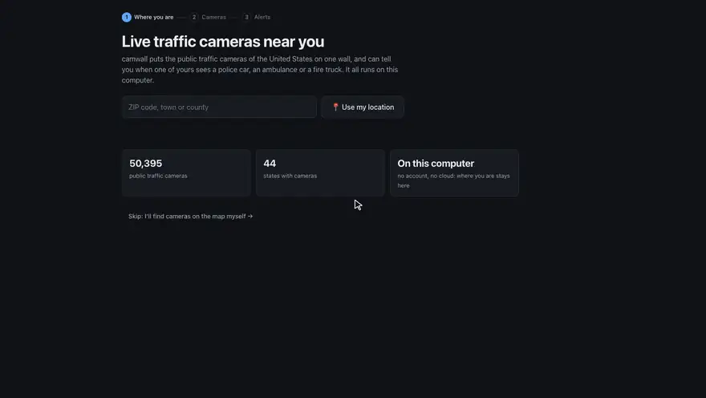
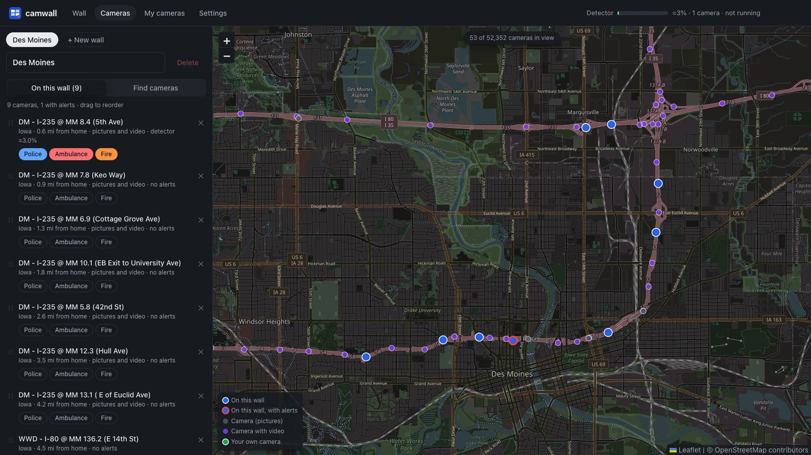
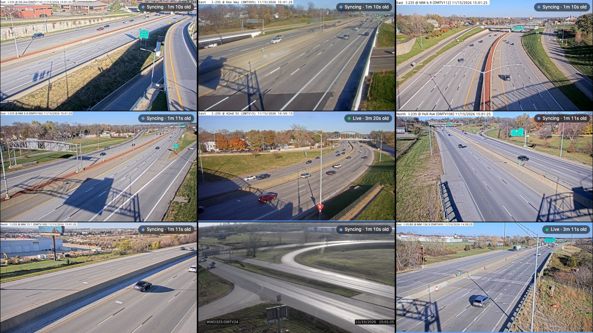

# camwall

camwall puts live traffic cameras from across the United States on one wall: about 64,000 of them (over 50,000 on from
the start), from state DOTs, cities, counties, toll roads and bridges. It can tell you when one of your cameras sees an
ambulance, a fire truck or a police car, and it shows your own home or business cameras alongside them.

It runs on your own computer: no account, no cloud. It opens in your browser.

[](docs/demo.mp4)
*Setting up near Des Moines, the wall, one camera's live video, and the map of every camera. The
[full video](docs/demo.mp4) is 56 seconds. Pictures: Iowa DOT, CC BY 4.0.*

## Getting it

- **Downloads,** from this repository's Releases page:
  - **Mac:** open `camwall-<version>-mac-apple-silicon.dmg` (or `-mac-intel`) and drag camwall to Applications.
    The app isn't signed yet, so the first time macOS asks you to allow it: System Settings › Privacy & Security ›
    Open Anyway.
  - **Windows:** unzip `camwall-<version>-windows.zip` and double-click `camwall.bat`.
  - **Linux:** unpack `camwall-<version>-linux.tar.gz` and run `./camwall`.
- **From source,** with Python 3.11 or newer: `python3 camwall.py`. Only Python's standard library is needed, plus
  `ffmpeg` for your own cameras and for video-only public cameras.
- **Docker** (Linux): `docker compose up -d`, then open http://127.0.0.1:8780/ on the same machine. See below.

The first time, it asks where you are (a ZIP code or town, or "use my location"). It then shows the cameras near you
and asks which alerts you want.

## What it does

**Public cameras.** The camera lists come from state DOTs, cities, counties, toll roads and bridge authorities.
`sources/` has one adapter per source, and `research/COVERAGE.md` shows what each state has.

- **Cameras page:** find cameras on a map of the whole country, or search by road, place or ZIP code. Put them on
  **walls**: named sets you switch between with the number keys. The map uses OpenStreetMap's tiles, or another
  provider's set in Settings › Map; camwall fetches them and keeps each for a week.

  
- **Wall:**
  - each camera is checked just before its next picture is due;
  - replay the last five minutes as a time-lapse;
  - zoom into a picture;
  - black and white for night;
  - full screen.

  
- **Restricted sources:** some sources' terms restrict apps like this one. They're off until the user turns them on
  (Settings › Camera sources, which quotes their terms).

**Alerts.** Give a camera alerts for ambulances, fire trucks or police cars.

- The detector watches those cameras on this computer:
  - YOLO finds the vehicles in each picture;
  - two CLIP models judge each one, and both have to agree;
  - after dark, vehicles are judged in greyscale, so headlight glare isn't taken for police lights.
- An alert gives a chime, says what it saw and where, and shows a notification. Mute and quiet hours silence it.
- The wall also shows the alert's snapshot.
- The detector's libraries (about 1–2 GB) are installed when it's first turned on (Settings › Alerts).
- **It learns your cameras.** Mark alerts Real or Wrong in the wall's alert list:
  - a vehicle like one marked Wrong doesn't alert again;
  - after three Real marks of a kind, a small classifier for it is trained on this computer, against the ordinary
    vehicles it has seen.

**Your own cameras** (My cameras):

- Supported:
  - IP cameras and recorders (Reolink, Hikvision, Dahua/Amcrest/Lorex, Axis, Uniview, Tapo, Eufy, Foscam…);
  - hubs that bring in cameras with no stream of their own (Home Assistant, Frigate, go2rtc, Scrypted, Blue Iris,
    UniFi Protect, Synology). This is how Ring, Nest, Arlo and Blink cameras come in.
  - any RTSP, MJPEG, snapshot or HLS address.
- How you add one: find it on your network (ONVIF), pick its brand, or paste its address. Test it, then save it.
- Passwords are kept in the system keychain (macOS Keychain, Windows Credential Manager, or the Linux Secret
  Service). Without one, they're kept in a file in camwall's folder that only you can read.
- Video is decoded only while something is watching.
- **Known limitation:** while a camera is shown or recorded, its password is in ffmpeg's command line, which other
  users of the same computer can see in its process list. ffmpeg takes no other way to log in to an RTSP camera. On a
  computer shared with people who shouldn't have the password, give camwall a camera account that can only view.
- A camera can keep a rolling recording (2 hours to a week), shared with the live view on one connection, since some
  cameras allow only one. Recordings play back on the My cameras page. They're video only unless the camera's "Record
  its sound too" is on.
- Away from home, a camera can be reached through a tunnel: a SOCKS5 proxy into the home network, such as Tailscale's
  (run without a system VPN: `tailscaled --tun=userspace-networking --socks5-server=127.0.0.1:1055`) or `ssh -D`'s.
  camwall tries the camera directly first and uses the tunnel when it doesn't answer.

**For a screen left on.** Walls can switch by themselves every 15 seconds to 5 minutes.

**Phones and tablets.** In Settings, let devices on your Wi-Fi pair with camwall using a six-digit code shown on the
computer.

- A paired device sees the walls and can change them.
- Only the computer running camwall can change keys and passwords, quit camwall, or let devices in.

## How it fits together

```
camwall.py        starts the server (127.0.0.1:8780) and opens the browser
app/
  server.py       pages, JSON API, and the relay for pictures and video (/cam/, /hls/, /mjpeg/) and tiles (/tiles/)
  catalogue.py    every camera: shipped lists (data/catalogue/), refreshed daily on this computer for the
                  sources in use; the same camera from two sources is listed once
  relay.py        fetches only the URLs the lists name, and only from public addresses (redirects too); shares a
                  picture between viewers; rewrites HLS playlists; spots a source's "camera unavailable" stand-ins
  sets.py         walls and alerts            settings.py  preferences
  mine.py         your own cameras            onvif.py     discovery and stream addresses
  tunnel.py       reaching one through a SOCKS5 proxy when away from home
  tiles.py        the map's tiles, fetched under camwall's name and kept a week
  brands.py       cameras' usual addresses    secrets.py   passwords in the system keychain
  detector.py     installs and runs the detector
  devices.py      pairing phones and tablets  system.py    start at login; local addresses
detector/         the detector (its own process, with torch): models.py, watch.py, learn.py, notify.py
sources/          one module per camera source (see sources/__init__.py); python3 -m sources.check <module>;
                  tls.py fetches an intermediate certificate a server leaves out, as browsers do
tests/            python3 -m unittest discover tests
web/              the pages: wall, cameras, my cameras, settings, welcome, pair
tools/            build_places.py (ZIP codes and towns), build_catalogue.py, package.py (the downloads), coverage.py
```

User data (settings, walls, fetched lists, alerts, snapshots) goes in the system's app-data folder:
`~/Library/Application Support/camwall` on a Mac, `%LOCALAPPDATA%\camwall` on Windows, and
`~/.local/share/camwall` on Linux. `CAMWALL_DATA` overrides it.

## Building the downloads

```
python3 tools/build_catalogue.py      # fetch every shippable source's list into data/catalogue/
python3 tools/package.py all          # dist/: Mac .dmg (Apple Silicon and Intel), Windows .zip, Linux .tar.gz
python3 tools/coverage.py             # research/COVERAGE.md, from what sources.check last saved
```

Each download carries its own Python (python-build-standalone, checksum-verified) and today's camera lists.

## Docker

For a home server, or a screen left showing a wall. `compose.yaml` runs camwall with the host's network, so it behaves
as it does installed directly: its page is on the host's 127.0.0.1:8780 and nowhere else, and phones and tablets pair
on port 8781 once that's turned on.

```
docker compose up -d
```

- **On a server without a screen,** reach the page over SSH: `ssh -L 8780:127.0.0.1:8780 your-server`, then open
  http://127.0.0.1:8780/ on your own computer. To use it from phones and other computers without SSH, turn on Settings
  › Phones and tablets there, and pair each of them.
- **Your data** (settings, walls, alerts, your cameras) is in the `camwall-data` volume. Without a keychain in the
  container, your cameras' passwords are kept in a file there that only the container's user can read.
- **Alerts** show on the wall. The chime, the spoken alert and the notification come from the machine running camwall,
  so a server without speakers or a desktop doesn't have them.
- Host networking needs Linux, or Docker Desktop with host networking turned on.

## Camera sources and their terms

Each source's terms are recorded in its module and shown in Settings › Camera sources, which links its site and
terms. Pictures belong to the agencies that publish them.

- Sources whose terms restrict apps like this one are off until you turn them on, after reading their terms. They're
  never included in the downloads. Whether your use fits a source's terms is up to you.
- Where an agency asks for credit or a disclaimer, camwall shows it with that agency's cameras.
- `THIRD_PARTY.md` lists the code, data and models camwall includes or fetches, and their licences.
- Once a day camwall reads `data/withdrawn.json` from this repository on GitHub (see below). That, the cameras' own
  servers and the map's tiles are all it connects to.

## For agencies

camwall shows cameras that agencies publish for everyone, from the lists their own public pages use. How it fetches:

- **Each copy fetches** a source's camera list at most once a day, and only for sources its user uses. Pictures and
  video are fetched only while someone is looking at them, or for alerts the user turned on.
- **Every request says** `camwall/<version> (traffic camera viewer; +https://github.com/asifjahmed/camwall)` as its
  User-Agent, so you can tell camwall apart, or block it, at your own servers.
- **It doesn't** sign in, or pretend to be your own page: it sends no Referer or Origin of yours.

If you'd like camwall to stop using your cameras, or to change how it does (a credit, a disclaimer, an API you'd
rather it used), open an issue here. A removal goes into `data/withdrawn.json`, which every copy of camwall reads once a
day: your cameras are turned off in copies already installed, not only in new downloads, within a day of the change.
To report a security problem with your own systems that you'd rather not discuss in public, use this repository's
private vulnerability reporting (`SECURITY.md`).

## Contributing

Fixes and new camera sources are welcome: see `CONTRIBUTING.md`. Report security problems privately, as `SECURITY.md`
says.

## Licence

camwall is free software under the GNU Affero General Public License v3 (`LICENSE`).
